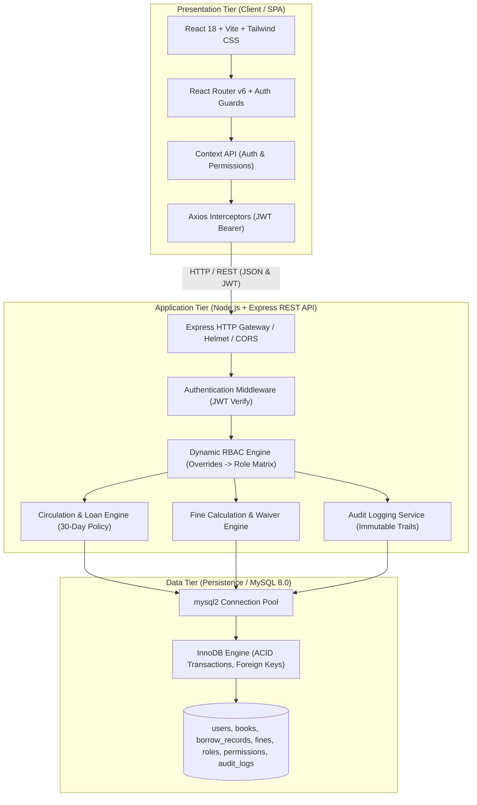
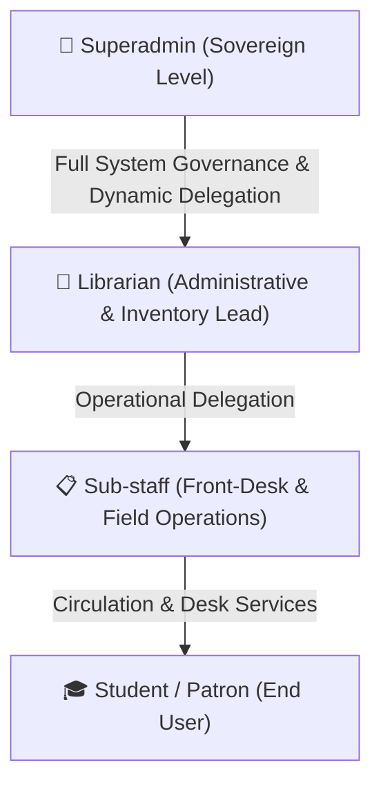
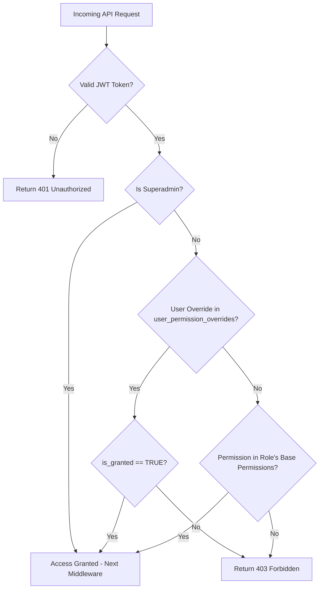
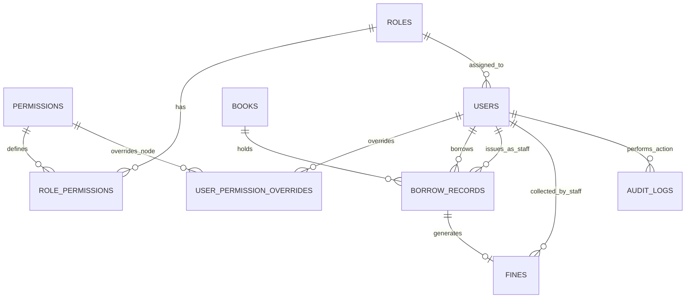

# 📚 Enterprise Library Management System (LMS)

[](https://react.dev/)
[](https://tailwindcss.com/)
[](https://nodejs.org/)
[](https://expressjs.com/)
[-4479A1?logo=mysql&logoColor=white>)](https://www.mysql.com/)
[](#)

An enterprise-grade, full-stack **Library Management System (LMS)** designed to automate the complete lifecycle of modern institutional and academic library operations. Built with a decoupled, high-performance architecture using **React (Vite) + Tailwind CSS**, **Node.js + Express**, and **MySQL 8.0 (InnoDB)**.

The platform provides real-time catalog discovery, automated circulation pipelines, strict 30-day loan enforcement with dynamic fine accrual, forensic audit trails, and a multi-tier **Role-Based Access Control (RBAC)** governance engine with dynamic per-user capability delegation.

---

## 📑 Table of Contents

- [1. Executive Summary & Project Vision](#1-executive-summary--project-vision)
- [2. System Architecture & Tech Stack](#2-system-architecture--tech-stack)
  - [High-Level Architecture](#high-level-architecture)
  - [Technology Breakdown](#technology-breakdown)
- [3. Core Modules & Functionalities](#3-core-modules--functionalities)
  - [3.1 User & Authentication Management](#31-user--authentication-management)
  - [3.2 Catalog & Inventory Management](#32-catalog--inventory-management)
  - [3.3 Circulation Engine](#33-circulation-engine)
  - [3.4 Fine Tracking & Fee Collection](#34-fine-tracking--fee-collection)
  - [3.5 Analytics, Reporting & Audit Logging](#35-analytics-reporting--audit-logging)
- [4. Multi-Tier Administrative Hierarchy & Governance](#4-multi-tier-administrative-hierarchy--governance)
  - [Role Hierarchy](#role-hierarchy)
  - [Dynamic Feature Delegation Architecture](#dynamic-feature-delegation-architecture)
- [5. 30-Day Loan Policy, Overdue Tracking & Real-Time Penalty Engine](#5-30-day-loan-policy-overdue-tracking--real-time-penalty-engine)
  - [5.1 30-Day Fixed Borrowing Duration](#51-30-day-fixed-borrowing-duration)
  - [5.2 Dedicated Student Dashboard & Overdue Alerts](#52-dedicated-student-dashboard--overdue-alerts)
  - [5.3 Automated Account Holds & Desk Verification](#53-automated-account-holds--desk-verification)
- [6. Granular Permission Matrix (RBAC)](#6-granular-permission-matrix-rbac)
- [7. Dynamic RBAC Authorization Flow](#7-dynamic-rbac-authorization-flow)
  - [Server-Side Authorization Engine](#server-side-authorization-engine)
  - [Client-Side Guard Architecture](#client-side-guard-architecture)
- [8. Database Relational Model & Schema](#8-database-relational-model--schema)
  - [Entity Relationship Overview](#entity-relationship-overview)
  - [Schema Entity Specifications](#schema-entity-specifications)
- [9. Stakeholder Benefits Analysis](#9-stakeholder-benefits-analysis)
- [10. Project Directory Structure](#10-project-directory-structure)
- [11. Installation & Getting Started](#11-installation--getting-started)
  - [Prerequisites](#prerequisites)
  - [Database Setup](#database-setup)
  - [Backend Setup](#backend-setup)
  - [Frontend Setup](#frontend-setup)
- [12. API Specification Overview](#12-api-specification-overview)

---

## 1. Executive Summary & Project Vision

Modern academic and institutional libraries face severe operational bottlenecks when reliant upon legacy or manual management workflows:

- **Manual Record-Keeping & Inefficiencies:** High human error rates in tracking borrower identity and book checkouts.
- **Static Cataloging:** Lack of real-time search, category indexing, and instantaneous inventory updates.
- **Circulation Bottlenecks:** Fragmented return tracking, uncollected overdue fines, and lack of accountability for lost assets.
- **Rigid Privilege Structures:** Inability to dynamically adjust staff permissions without rebuilding or re-deploying software.

This LMS addresses these challenges by delivering an enterprise-ready, robust, and scalable platform that streamlines daily library activities, guarantees complete transactional consistency, and ensures transparent operational governance.

---

## 2. System Architecture & Tech Stack

### High-Level Architecture

The platform operates on a classic, decoupled **Three-Tier Architecture** that enforces clean separation of concerns, high throughput, data integrity, and strict ACID compliance.



### Technology Breakdown

| Tier         | Component           | Technology                       | Rationale / Capabilities                                                                  |
| :----------- | :------------------ | :------------------------------- | :---------------------------------------------------------------------------------------- |
| **Frontend** | Build Tool & SPA    | **React.js 18 + Vite**           | Fast HMR, functional components, hooks, high performance.                                 |
|              | Styling             | **Tailwind CSS**                 | Utility-first, responsive, custom design tokens, dark mode ready.                         |
|              | Icons               | **Lucide-React**                 | Clean, modern vector iconography.                                                         |
|              | Routing & Guards    | **React Router v6**              | Declarative routing with client-side RBAC protection wrappers.                            |
|              | HTTP Client         | **Axios**                        | Request/Response interceptors for automated JWT injection and refresh.                    |
| **Backend**  | Runtime & Server    | **Node.js v18 LTS + Express.js** | Non-blocking asynchronous I/O, RESTful endpoint architecture.                             |
|              | Security & Auth     | **JWT + bcrypt + Helmet + CORS** | Stateless authentication, salted password hashing (factor 12), secure HTTP headers.       |
|              | Validation          | **express-validator**            | Strict sanitization and structural payload validation.                                    |
|              | Task Scheduler      | **node-cron**                    | Nightly automated cron jobs for 30-day overdue loan detection and daily fine accrual.     |
| **Database** | Relational Database | **MySQL 8.0 (InnoDB Engine)**    | Strict ACID compliance, relational integrity, row-level locking, foreign key constraints. |
|              | Driver              | **mysql2**                       | High-performance client with optimized connection pooling.                                |

---

## 3. Core Modules & Functionalities

### 3.1 User & Authentication Management

- **Dual-Token JWT Authentication:** Short-lived access tokens (15 minutes) paired with secure refresh tokens (7 days stored in `HttpOnly`, `SameSite` cookies).
- **Profile Engine:** Self-service profile updates, credential resets, status toggling (`Active`, `Suspended`, `Archived`).
- **Institutional Membership Cards:** Generates digital patron identification passes containing user ID, role badge, and barcode.

### 3.2 Catalog & Inventory Management

- **Holding Metadata Processing:** Full CRUD operations for books, indexed by ISBN, Title, Author, Category, Publisher, and Edition Year.
- **Dual-Counter Inventory Control:** Dynamically tracks `total_copies` versus `available_copies` across all catalog additions, issues, returns, and damages.
- **Physical Asset Tagging:** Unique Barcode / Asset Identification numbers per physical copy with shelf location tags.

### 3.3 Circulation Engine

- **Issue Pipeline:** Transactional checkout enforcing maximum loan quotas per role, identity validation, and book availability checks.
- **Return Pipeline:** Transactional return processing that verifies active loan terms, evaluates overdue durations, calculates accrued fine totals, releases copy reservations, and transitions book availability states back to `AVAILABLE`.
- **Reservations & Renewals:** Automated hold placements for checked-out items; dynamic renewal controls subject to queue reservations and active fine caps.

### 3.4 Fine Tracking & Fee Collection

- **Automated Cron Accrual:** Scheduled background jobs calculate daily fine increments for items exceeding the 30-day loan period based on institutional fee policies.
- **Payment Ledger:** Multi-payment method support (`Cash`, `Online`, `Account Waiver`) with generation of immutable transaction receipts and balance reconciliation.

### 3.5 Analytics, Reporting & Audit Logging

- **Operational Dashboards:** Real-time data visualization showing inventory distribution, circulation velocity, top-borrowed titles, and default rates.
- **Forensic Audit Logging:** Immutable audit records capturing Actor ID, Target Resource, Action Key, Mutation Payload (JSON), IP Address, and Timestamp.

---

## 4. Multi-Tier Administrative Hierarchy & Governance

The platform implements a structured 4-tier operational hierarchy designed for academic and institutional governance:



### Role Hierarchy

1. **👑 Superadmin (Sovereign Level):**
   - Unrestricted, global governance over the entire platform.
   - Exclusive authority to configure System Roles, Base Permissions, and System Settings.
   - Capability to grant or revoke dynamic permission overrides on a per-user basis.
   - Unrestricted access to forensic system audit logs.

2. **📖 Librarian (Administrative & Inventory Lead):**
   - Full management of catalog inventory, acquisitions, book purges, and categories.
   - Manages patron accounts, manual account status overrides, and membership tier adjustments.
   - Generates systemic inventory, financial, and circulation reports.

3. **📋 Sub-staff (Front-Desk & Field Operations):**
   - Executes day-to-day front-desk circulation workflows: Issue, Return, Renew.
   - Collects fine payments and reports damaged inventory.
   - Read-only access to basic patron profiles to verify identity during transactions.

4. **🎓 Student / Patron (End User):**
   - Self-service digital catalog browsing, filtering, and availability search.
   - Personal circulation dashboard: active loans, 30-day countdowns, overdue warnings, and reservation queues.

### Dynamic Feature Delegation Architecture

The governance system allows the Superadmin to perform **Dynamic Capability Delegation**.

> _Example:_ If operational load requires Front-Desk Sub-staff to process fine waivers (normally restricted to Librarians), the Superadmin can grant the specific capability `fines.waive` directly to targeted Sub-staff accounts via the `user_permission_overrides` table without altering the global Sub-staff role definition.

---

## 5. 30-Day Loan Policy, Overdue Tracking & Real-Time Penalty Engine

```
 Checkout Date                                                 30-Day Due Date             Overdue Period
     │◄─────────────────────── 30 Days Standard Loan Window ───────────────────────►│◄────── Daily Penalty Accrual ──────►
     ▼                                                                              ▼
[ BOOK ISSUED ] ─────────────────────────────────────────────────────────────► [ DUE DATE ] ────────► [ OVERDUE: $ / Day ]
(Active Status)                                                              (Automated Transition)     (Borrowing Freeze)
```

### 5.1 30-Day Fixed Borrowing Duration

- Enforces a standard **30-day fixed loan policy** for all student borrowing transactions.
- The circulation engine records the issue timestamp and calculates the strict due date exactly `issued_at + 30 calendar days`.

### 5.2 Dedicated Student Dashboard & Overdue Alerts

The student portal provides real-time circulation monitoring:

- ⏱️ **Real-Time Loan Countdown:** Dynamic day counter showing days remaining within the 30-day window.
- ⚠️ **Automated Overdue Transition:** Immediate transition of loan status to `OVERDUE` once the 30-day period expires.
- 🚨 **Prominent Visual Indicators:** Overdue titles highlighted with prominent red alert banners, warning cards, and high-visibility status badges.
- 📊 **Itemized Overdue Breakdown:**
  - Exact days overdue (e.g., `"5 days late"`).
  - Configured daily penalty rate (e.g., `₹5 / day` or `$1 / day`).
  - Total accumulated fine amount.
  - Original checkout timestamp and due date.

### 5.3 Automated Account Holds & Desk Verification

- 🔒 **Automated Borrowing Freeze:** An active overdue status instantly freezes the student's borrowing and reservation rights until the overdue item is returned and outstanding fines are cleared.
- 🛑 **Front-Desk Red Alert Flag:** When staff look up a patron profile at the circulation desk, the system displays an alert banner warning of outstanding overdue items and unpaid fees.

---

## 6. Granular Permission Matrix (RBAC)

Capabilities are mapped to explicit dot-notation keys evaluated at both the API route layer and the frontend component render layer:

| Functional Area       | Permission Key            | Superadmin | Librarian |    Sub-staff     |   Student   |
| :-------------------- | :------------------------ | :--------: | :-------: | :--------------: | :---------: |
| **Catalog**           | `catalog.read`            |     ✅     |    ✅     |        ✅        |     ✅      |
|                       | `catalog.create`          |     ✅     |    ✅     |        ❌        |     ❌      |
|                       | `catalog.update`          |     ✅     |    ✅     |        ❌        |     ❌      |
|                       | `catalog.delete`          |     ✅     |    ✅     |        ❌        |     ❌      |
| **Circulation**       | `circulation.issue`       |     ✅     |    ✅     |        ✅        |     ❌      |
|                       | `circulation.return`      |     ✅     |    ✅     |        ✅        |     ❌      |
|                       | `circulation.renew`       |     ✅     |    ✅     |        ✅        | ✅ _(Self)_ |
|                       | `circulation.reserve`     |     ✅     |    ✅     |        ✅        |     ✅      |
| **Fines**             | `fines.read`              |     ✅     |    ✅     |        ✅        | ✅ _(Self)_ |
|                       | `fines.collect`           |     ✅     |    ✅     |        ✅        |     ❌      |
|                       | `fines.waive`             |     ✅     |    ✅     | ⚡ _(Delegable)_ |     ❌      |
| **Patron Management** | `patrons.read`            |     ✅     |    ✅     |   ✅ _(Basic)_   |     ❌      |
|                       | `patrons.create`          |     ✅     |    ✅     |        ❌        |     ❌      |
|                       | `patrons.update`          |     ✅     |    ✅     |        ❌        |     ❌      |
|                       | `patrons.delete`          |     ✅     |    ✅     |        ❌        |     ❌      |
| **Governance**        | `system.roles.manage`     |     ✅     |    ❌     |        ❌        |     ❌      |
|                       | `system.overrides.manage` |     ✅     |    ❌     |        ❌        |     ❌      |
|                       | `system.audit.read`       |     ✅     |    ❌     |        ❌        |     ❌      |

_(Legend: ✅ = Granted by Default | ❌ = Denied | ⚡ = Delegable via User Overrides | Self = Restricted to Own Records)_

---

## 7. Dynamic RBAC Authorization Flow

### Server-Side Authorization Engine

Every incoming request to a protected API route passes through the centralized RBAC middleware:



### Client-Side Guard Architecture

- **Protected Routes:** React Router route wrapper `<ProtectedRoute requiredPermission="catalog.create">` verifies permissions stored in Auth Context.
- **Component-Level Rendering:** UI elements (such as `Add Book` or `Waive Fine` buttons) use custom hooks (e.g. `const { hasPermission } = useAuth();`) to conditionally render controls.
- **Graceful Fallback:** Unauthorized navigation triggers a styled `403 Access Denied` view specifying the missing permission node.

---

## 8. Database Relational Model & Schema

### Entity Relationship Overview



### Schema Entity Specifications

```sql
-- 1. Roles Definition
CREATE TABLE roles (
    id INT AUTO_INCREMENT PRIMARY KEY,
    name VARCHAR(50) NOT NULL UNIQUE,
    description VARCHAR(255),
    created_at TIMESTAMP DEFAULT CURRENT_TIMESTAMP,
    updated_at TIMESTAMP DEFAULT CURRENT_TIMESTAMP ON UPDATE CURRENT_TIMESTAMP
) ENGINE=InnoDB;

-- 2. Granular Permissions Registry
CREATE TABLE permissions (
    id INT AUTO_INCREMENT PRIMARY KEY,
    permission_key VARCHAR(100) NOT NULL UNIQUE,
    module VARCHAR(50) NOT NULL,
    description VARCHAR(255),
    created_at TIMESTAMP DEFAULT CURRENT_TIMESTAMP
) ENGINE=InnoDB;

-- 3. Base Role-Permission Mapping
CREATE TABLE role_permissions (
    role_id INT NOT NULL,
    permission_id INT NOT NULL,
    PRIMARY KEY (role_id, permission_id),
    FOREIGN KEY (role_id) REFERENCES roles(id) ON DELETE CASCADE,
    FOREIGN KEY (permission_id) REFERENCES permissions(id) ON DELETE CASCADE
) ENGINE=InnoDB;

-- 4. Users Entity
CREATE TABLE users (
    id INT AUTO_INCREMENT PRIMARY KEY,
    role_id INT NOT NULL,
    full_name VARCHAR(150) NOT NULL,
    email VARCHAR(150) NOT NULL UNIQUE,
    password_hash VARCHAR(255) NOT NULL,
    phone VARCHAR(20),
    status ENUM('Active', 'Suspended', 'Archived') DEFAULT 'Active',
    created_at TIMESTAMP DEFAULT CURRENT_TIMESTAMP,
    updated_at TIMESTAMP DEFAULT CURRENT_TIMESTAMP ON UPDATE CURRENT_TIMESTAMP,
    FOREIGN KEY (role_id) REFERENCES roles(id)
) ENGINE=InnoDB;

-- 5. Dynamic User Permission Overrides (Delegation Engine)
CREATE TABLE user_permission_overrides (
    id INT AUTO_INCREMENT PRIMARY KEY,
    user_id INT NOT NULL,
    permission_id INT NOT NULL,
    is_granted BOOLEAN NOT NULL DEFAULT TRUE,
    granted_by INT NOT NULL,
    created_at TIMESTAMP DEFAULT CURRENT_TIMESTAMP,
    UNIQUE KEY uq_user_perm (user_id, permission_id),
    FOREIGN KEY (user_id) REFERENCES users(id) ON DELETE CASCADE,
    FOREIGN KEY (permission_id) REFERENCES permissions(id) ON DELETE CASCADE,
    FOREIGN KEY (granted_by) REFERENCES users(id)
) ENGINE=InnoDB;

-- 6. Books Catalog
CREATE TABLE books (
    id INT AUTO_INCREMENT PRIMARY KEY,
    isbn VARCHAR(20) NOT NULL UNIQUE,
    title VARCHAR(255) NOT NULL,
    author VARCHAR(255) NOT NULL,
    category VARCHAR(100) NOT NULL,
    publisher VARCHAR(150),
    publication_year INT,
    total_copies INT NOT NULL DEFAULT 1,
    available_copies INT NOT NULL DEFAULT 1,
    shelf_location VARCHAR(50),
    created_at TIMESTAMP DEFAULT CURRENT_TIMESTAMP,
    updated_at TIMESTAMP DEFAULT CURRENT_TIMESTAMP ON UPDATE CURRENT_TIMESTAMP
) ENGINE=InnoDB;

-- 7. Circulation & 30-Day Loan Records
CREATE TABLE borrow_records (
    id INT AUTO_INCREMENT PRIMARY KEY,
    user_id INT NOT NULL,
    book_id INT NOT NULL,
    staff_id INT NOT NULL,
    issue_date TIMESTAMP DEFAULT CURRENT_TIMESTAMP,
    due_date TIMESTAMP NOT NULL, -- Automatically calculated: issue_date + INTERVAL 30 DAY
    return_date TIMESTAMP NULL,
    status ENUM('Borrowed', 'Returned', 'Overdue', 'Lost') DEFAULT 'Borrowed',
    created_at TIMESTAMP DEFAULT CURRENT_TIMESTAMP,
    FOREIGN KEY (user_id) REFERENCES users(id),
    FOREIGN KEY (book_id) REFERENCES books(id),
    FOREIGN KEY (staff_id) REFERENCES users(id)
) ENGINE=InnoDB;

-- 8. Fines & Penalty Ledger
CREATE TABLE fines (
    id INT AUTO_INCREMENT PRIMARY KEY,
    borrow_id INT NOT NULL UNIQUE,
    amount DECIMAL(10,2) NOT NULL DEFAULT 0.00,
    status ENUM('Unpaid', 'Paid', 'Waived') DEFAULT 'Unpaid',
    paid_at TIMESTAMP NULL,
    collected_by INT NULL,
    waiver_reason VARCHAR(255) NULL,
    created_at TIMESTAMP DEFAULT CURRENT_TIMESTAMP,
    updated_at TIMESTAMP DEFAULT CURRENT_TIMESTAMP ON UPDATE CURRENT_TIMESTAMP,
    FOREIGN KEY (borrow_id) REFERENCES borrow_records(id) ON DELETE CASCADE,
    FOREIGN KEY (collected_by) REFERENCES users(id)
) ENGINE=InnoDB;

-- 9. Immutable Forensic Audit Trail
CREATE TABLE audit_logs (
    id BIGINT AUTO_INCREMENT PRIMARY KEY,
    actor_id INT NULL,
    action_key VARCHAR(100) NOT NULL,
    target_resource VARCHAR(100),
    payload JSON NULL,
    ip_address VARCHAR(45),
    user_agent VARCHAR(255),
    created_at TIMESTAMP DEFAULT CURRENT_TIMESTAMP,
    FOREIGN KEY (actor_id) REFERENCES users(id) ON DELETE SET NULL
) ENGINE=InnoDB;
```

---

## 9. Stakeholder Benefits Analysis

| Stakeholder Persona       | Traditional Operational Pain Points                                                             | LMS Platform Solution & Value Delivered                                                                                        |
| :------------------------ | :---------------------------------------------------------------------------------------------- | :----------------------------------------------------------------------------------------------------------------------------- |
| **Students / Patrons**    | Physical catalog searching, unexpected late fees, unverified inventory status.                  | Real-time digital search, automated return deadline notifications, transparent self-service dashboards with 30-day countdowns. |
| **Front-Desk Sub-staff**  | Manual checkout log books, error-prone manual fee calculations, slow desk processing.           | Barcode-based checkout/return workflows, automated fine calculations, instant student identity & hold status verification.     |
| **Librarians**            | Time-consuming physical audits, fragmented acquisition records, inflexible permissions.         | Automated real-time catalog tracking, digital reservation queues, granular operational control.                                |
| **University Executives** | Zero cross-departmental visibility, untracked book loss rates, lack of compliance/audit trails. | Real-time analytics dashboards, central operational control, comprehensive immutable security audit logging.                   |

---

## 10. Project Directory Structure

```plaintext
library-management/
├── client/                           # Frontend (React 18 + Vite + Tailwind CSS)
│   ├── public/                       # Static public assets
│   ├── src/
│   │   ├── assets/                   # Images, logos, and illustrations
│   │   ├── components/               # Modular UI components
│   │   │   ├── common/               # Buttons, Inputs, Modal, Badge, Alerts
│   │   │   ├── layout/               # Navbar, Sidebar, PageContainer
│   │   │   └── guards/               # ProtectedRoute.jsx, RBACGuard.jsx
│   │   ├── context/                  # AuthContext.jsx (Tokens, Permissions state)
│   │   ├── hooks/                    # useAuth.js, useCirculation.js
│   │   ├── pages/                    # Views
│   │   │   ├── auth/                 # Login.jsx, Register.jsx
│   │   │   ├── student/              # StudentDashboard.jsx, OverdueAlerts.jsx
│   │   │   ├── catalog/              # BookCatalog.jsx, BookDetails.jsx
│   │   │   ├── circulation/          # CheckoutDesk.jsx, ReturnsDesk.jsx
│   │   │   ├── admin/                # RoleManager.jsx, OverrideManager.jsx
│   │   │   └── analytics/            # ReportsDashboard.jsx, AuditLogs.jsx
│   │   ├── services/                 # Axios API clients (api.js, authService.js)
│   │   ├── App.jsx                   # Main routing configuration
│   │   ├── main.jsx                  # Entry point
│   │   └── index.css                 # Tailwind CSS styles & design tokens
│   ├── index.html
│   ├── tailwind.config.js
│   ├── vite.config.js
│   └── package.json
│
├── server/                           # Backend (Node.js + Express.js)
│   ├── src/
│   │   ├── config/                   # db.js (MySQL Pool), jwt.js
│   │   ├── controllers/              # Request handlers (auth, catalog, circulation)
│   │   ├── middleware/               # auth.js, rbac.js, validate.js, audit.js
│   │   ├── routes/                   # authRoutes.js, bookRoutes.js, loanRoutes.js
│   │   ├── services/                 # fineScheduler.js (Cron), circulationService.js
│   │   └── app.js                    # Express app initialization
│   ├── server.js                     # Server entry point
│   └── package.json
│
├── database/                         # Database Migration & Seed Scripts
│   ├── schema.sql                    # MySQL tables & constraints definition
│   └── seed.sql                      # Initial seed (Roles, Superadmin, Permissions)
│
└── README.md                         # Comprehensive System Specification
```

---

## 11. Installation & Getting Started

### Prerequisites

- **Node.js**: `v18.0.0` or higher
- **npm**: `v9.0.0` or higher
- **MySQL Server**: `v8.0` or higher

### Database Setup

1. Log in to MySQL CLI or MySQL Workbench:
   ```bash
   mysql -u root -p
   ```
2. Create database and apply the schema:
   ```sql
   CREATE DATABASE library_db CHARACTER SET utf8mb4 COLLATE utf8mb4_unicode_ci;
   USE library_db;
   SOURCE database/schema.sql;
   SOURCE database/seed.sql;
   ```

### Backend Setup

1. Navigate to the server directory:
   ```bash
   cd server
   npm install
   ```
2. Create a `.env` file in `server/`:
   ```env
   PORT=5000
   NODE_ENV=development
   DB_HOST=localhost
   DB_USER=root
   DB_PASSWORD=your_mysql_password
   DB_NAME=library_db
   DB_PORT=3306
   JWT_SECRET=super_secret_jwt_access_key
   JWT_REFRESH_SECRET=super_secret_jwt_refresh_key
   CLIENT_URL=http://localhost:5173
   ```
3. Start the backend development server:
   ```bash
   npm run dev
   ```
   _The server will boot on `http://localhost:5000` with automated cron jobs running._

### Frontend Setup

1. Navigate to the client directory:
   ```bash
   cd client
   npm install
   ```
2. Create a `.env` file in `client/`:
   ```env
   VITE_API_BASE_URL=http://localhost:5000/api
   ```
3. Launch the Vite development server:
   ```bash
   npm run dev
   ```
   _Access the web dashboard in your browser at `http://localhost:5173`._

---

## 12. API Specification Overview

| Method   | Endpoint                    | Description                             | Required Permission       |
| :------- | :-------------------------- | :-------------------------------------- | :------------------------ |
| `POST`   | `/api/auth/login`           | Patron / Staff login & token issuance   | Public                    |
| `POST`   | `/api/auth/refresh`         | Refresh expired access token            | Authenticated             |
| `GET`    | `/api/books`                | Search & list catalog books             | `catalog.read`            |
| `POST`   | `/api/books`                | Add a new book to catalog               | `catalog.create`          |
| `PUT`    | `/api/books/:id`            | Update book metadata / copies           | `catalog.update`          |
| `DELETE` | `/api/books/:id`            | Remove book entry                       | `catalog.delete`          |
| `POST`   | `/api/circulation/issue`    | Issue book (Starts 30-day loan)         | `circulation.issue`       |
| `POST`   | `/api/circulation/return`   | Return book & compute late fees         | `circulation.return`      |
| `POST`   | `/api/circulation/renew`    | Renew active loan                       | `circulation.renew`       |
| `GET`    | `/api/circulation/my-loans` | Student active loans & countdown        | Authenticated (Patron)    |
| `GET`    | `/api/fines`                | List outstanding & paid fines           | `fines.read`              |
| `POST`   | `/api/fines/:id/collect`    | Record fine payment                     | `fines.collect`           |
| `POST`   | `/api/fines/:id/waive`      | Waive fine with justification           | `fines.waive`             |
| `GET`    | `/api/admin/roles`          | List all roles & permissions            | `system.roles.manage`     |
| `POST`   | `/api/admin/overrides`      | Create dynamic user permission override | `system.overrides.manage` |
| `GET`    | `/api/admin/audit-logs`     | Query forensic audit trails             | `system.audit.read`       |

---

## 📄 License & Attribution

This project is developed for institutional library operations. All rights reserved.
For support or inquiries, please contact the development team at [teampydahsoft](https://github.com/teampydahsoft).
